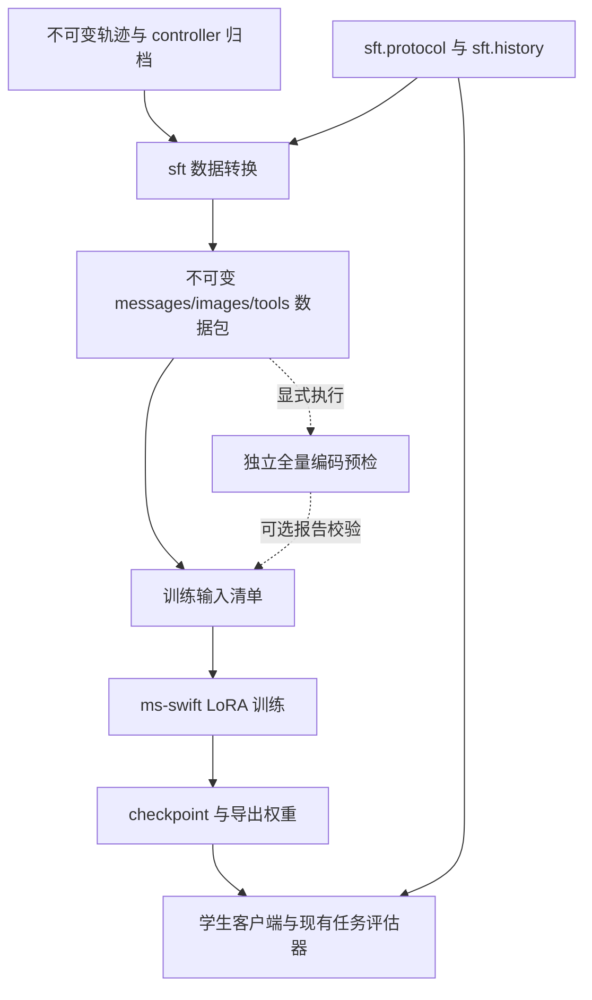

# Qwen3.5 4B SFT 文件架构设计

建议保留 `manipulation_agent.sft` 作为 CPU 数据准备与学生协议模块，新增
`manipulation_agent.training` 负责 ms-swift 编码检查、LoRA 训练和权重导出。
实验参数放到 `configs/training/`，机器路径通过命令行或环境变量传入，
`scripts/` 只保留薄入口。这样可以直接消费已有 SFT 数据包，并让后续学生推理复用现有协议。

本设计中的“千问 4B”按当前数据说明和参考训练脚本统一为 **Qwen3.5-4B**。
这是带视觉编码器的模型，与当前四视角 RGB 输入相匹配，模型信息见
[Qwen 官方模型卡](https://huggingface.co/Qwen/Qwen3.5-4B)。
CPU 转换整理与训练工具链接口已实现，实际命令见 [训练指南](sft_training.md)。
真实编码、GPU 训练及导出状态以各次运行记录为准；学生在线客户端仍为后续工作。

2026-11-04 上下文策略更新：转换器 v1.3.0 新增 `rgb_window_budget_v1`，默认粗估预算 24,576，
超限后先减旧图再删除旧调用组。训练入口兼容新策略包和既有 v1.2.1 全图包，保留真实编码预检。
下面的现有数据统计及已完成实验记录描述原始全图数据包；新转换策略不追溯修改历史数据。

2026-11-05 启动流程更新：训练不再自动执行 CPU 全量预检或逐条 loader 编码核验。
`preflight` 保留为独立命令，`train --preflight` 为可选的已有报告校验；新训练和恢复均记录实际检查状态。

## 现有数据对架构的要求

当前数据包位于 `/mnt/nas/home--liqi/latest94_scene_split`。2026 年 11 月 3 日的
`build.json`、`stats.json` 和 `sample_sources.jsonl` 记录如下：

| 项目 | 当前值 |
|---|---|
| 转换版本 | `manipulation_sft_v1.2` |
| 合格轨迹 | 94 条 |
| 训练和验证样本 | 2,989 / 334，共 3,323 条 |
| 划分 | 场景隔离，训练 5 个场景、验证 3 个场景 |
| 目标工具 | initialize、list_skills、read_skill、task_notes、act、finish、look |
| 包内去重图片 | 9,584 张 |
| 每样本图片数量 | 中位数 40，P95 为 340，最大 704；含无图样本 |
| 长度估算 | 均值约 24,519、最大 122,164，采用字符数和图片数粗估 |
| 真实编码长度 | 中位数 28,725，P95 为 404,577，最大 828,233；338 条超过模型容量 |
| 验证级别 | 3,323 条真实编码通过；GPU 冒烟因 OOM 未通过，后续测试已由用户取消 |

`K=2` 保留最近两次 RGB 回执的完整文本，较早回执进行文本压缩，**历史图片仍全部保留**。
默认预算仍为 16,384；本轮经用户确认通过命令行覆盖为 17,408，预算内 train/val 为
927/109，保持原始场景划分。实际状态与证据见 [训练指南](sft_training.md#本轮验证记录2026-11-04)。
因此它并不把输入限制为八张图片。粗估长度也不能用于判断样本是否能放进 Qwen 的上下文。
这要求训练侧拥有独立的全量编码预检，并显式处理长样本。

保留既有 `train.jsonl` / `val.jsonl` 及场景划分。训练器不能再按行随机切分，
同一场景的重复尝试和同一轨迹的不同决策必须留在同一侧。
未来增加独立测试集时，先固定测试场景，再构建训练和验证包。

## 对现有转换器的调整

当前模块划分总体合理。建议做以下有限调整，不把所有功能重新放进训练脚本。

| 现有位置 | 评估 | 设计调整 |
|---|---|---|
| `sft/protocol.py` | 坐标、schema 和接口文本转换边界清楚 | 保留位置和公开 API，供转换及学生推理共用 |
| `sft/history.py` | 同时包含历史压缩和 ms-swift 行格式转换 | 保留压缩；将格式转换、行校验和粗估移入 `sft/format.py` |
| `sft/source.py` | 517 行，混合事件读取、归档工具目录恢复和图片校验 | 保留事件解析与对齐；抽出 `snapshot.py` 和 `assets.py` |
| `sft/dataset.py` | 237 行，承担样本生成、场景划分和数据包写出 | 第一版保留；目前没有必要再拆成多个小模块 |
| `sft/verify_encode.py` | 单条编码检查合理，但未与训练配置绑定 | 实现迁入 `training/encoding.py`，旧模块保留延迟导入的兼容入口 |
| `tests/test_sft_dataset.py` | 812 行，覆盖多种模块职责 | 将协议、历史、来源和格式测试按职责迁出，共享合成 fixture |

`sft/common.py` 的严格 JSON、路径和错误处理继续共用。`Episode`、`Decision` 等类型
先留在 `source.py`；抽出的辅助模块通过参数和返回值传递元数据，避免反向导入 `source.py`。

现有 `manip-sft` 命令、构建脚本和 `manipulation_agent.sft` 导出的四个共享函数保持兼容。
`history.py` 中迁出的已有导入名称可暂时重导出。文件移动本身不改变数据格式、压缩行为、
场景划分或样本标签；以原有逐样本序列化哈希一致作为重构验收条件。

## 建议目录

下列树以仓库根目录为基准，标注了新增或调整的职责。实现时随功能增加文件。

```text
src/manipulation_agent/
├── sft/                              # 标准库即可运行的转换与共享协议
│   ├── __init__.py                   # 保持当前公开 API
│   ├── common.py                     # 严格 JSON、错误、路径和哈希
│   ├── protocol.py                   # point ↔ point_2d、schema、接口文本
│   ├── history.py                    # 训推共用的确定性历史压缩
│   ├── source.py                     # Codex 事件、决策边界、证据对齐
│   ├── snapshot.py                   # 抽出：归档源码与工具目录恢复
│   ├── assets.py                     # 抽出：四相机图片、标签和哈希校验
│   ├── format.py                     # 抽出：messages/images/tools 行格式
│   ├── dataset.py                    # 样本生成、场景划分、不可变包写出
│   ├── cli.py                        # 原有 manip-sft
│   └── verify_encode.py              # 旧编码命令的兼容入口
├── training/                         # 新增；仅执行相关命令时加载训练依赖
│   ├── __init__.py                   # 不导入 torch、swift 或 transformers
│   ├── artifacts.py                  # 指纹、结构化错误、原子写入与 journal
│   ├── config.py                     # 配置解析、校验、合成与指纹
│   ├── data.py                       # 读取数据包、解析图片路径、训练清单
│   ├── encoding.py                   # 与训练一致的预处理、模板和标签检查
│   ├── preflight.py                  # 全量编码统计、长度与覆盖率检查
│   ├── swift_backend.py              # 固定版本 ms-swift 的参数适配
│   ├── swift_plugin.py               # 原生回调审计、固定四步计划的中点保存
│   ├── swift_loss.py                 # default 监督语义的 message/EOS mask 修正
│   ├── run.py                        # 启动、恢复、日志与训练来源记录
│   ├── export.py                     # checkpoint 固定、LoRA merge、导出检查
│   └── cli.py                        # manip-train preflight/train/export
└── clients/                          # 学生在线运行的后续接入点

configs/training/
├── qwen35_4b_lora.toml                # 模型、模板、LoRA 与优化器配置
├── smoke.toml                        # 小规模真实数据验证的参数覆盖
└── launch/
    ├── single_gpu.toml               # 进程数、计算后端、数据加载设置
    └── ddp_2gpu.toml                 # 两卡启动设置；GPU 选择由环境传入

requirements/
├── training.in                       # 训练环境的直接依赖
└── training.lock.txt                 # 验证后固定的精确依赖版本

scripts/
├── build_manipulation_sft_dataset.py  # 原有转换入口
└── manipulation_training.py          # 新增训练 CLI 薄入口

tests/
├── sft_fixtures.py                   # 迁出的合成轨迹 fixture
├── test_sft_dataset.py               # 数据包、切分和兼容行为
├── test_sft_source.py                # 归档、事件与图片证据
├── test_sft_protocol.py
├── test_sft_history.py
├── test_sft_format.py
├── test_training_config.py           # 配置校验，无训练依赖
├── test_training_data.py             # 图片路径、来源、训练清单
├── test_training_backend.py          # 参数、恢复、导出元数据
└── integration/
    ├── test_qwen_sft_encode.py        # 真实 processor/template，无需模型权重
    └── test_qwen_sft_smoke.py         # 实际 GPU 训练、恢复与导出

docs/
├── sft_dataset.md                    # 现有数据契约及转换用法
├── sft_training_architecture.md      # 本设计
└── sft_training.md                   # 实现后的安装、训练、恢复与导出指南
```

保留 `sft/` 里的共享协议，可以直接维持现有导入路径；单独增加 `student/` 包目前收益有限。
后续在线客户端只需要导入 `sft.protocol` 和 `sft.history`。

## 模块边界与数据流



普通 `sft` 导入和转换不依赖 `training`、torch、transformers 或模拟器。
仅兼容命令 `sft.verify_encode` 在被调用时进入可选训练模块。
`training` 可以调用 `sft.format` 等 CPU 帮助函数，但读取数据包时不重新加载原始轨迹，
不恢复归档 Python，也不重新压缩已经转换好的样本。
模拟器仍由现有 OmniGibson adapter 管理，训练代码不导入模拟器。

训练层复用 ms-swift 的 trainer、collator、优化器与 checkpoint 机制。
`swift_backend.py` 只适配当前锁定版本，并提供预检与训练共用的模板初始化方法；
`run.py` 负责进程和记录。第一版无需自建 Trainer 或通用多框架后端体系。

## 训练数据与编码契约

`training/data.py` 只接收 `build.json` 为 `complete` 的数据包，验证文件、图片哈希及
训练和验证来源。每行通过 `(source_id, decision_index, call_id)` 关联到来源 sidecar，
同时记录原文件、行号和内容哈希。

数据包内图片路径以包根目录解析。为避免 ms-swift 的工作目录影响图片读取，
在训练输出目录生成派生的 `prepared/train.jsonl` 和 `prepared/val.jsonl`，将图片地址解析为
绝对路径；其余消息、工具、loss 字段及图片顺序保持一致。原始数据包始终只读。

编码预检必须与实际训练使用相同的 processor、模板、工具调用预处理、thinking 设置、
图片分辨率和 loss 配置。ms-swift 支持 `messages/images/tools`、OpenAI 工具调用预处理及
逐 assistant 的 `loss` 控制，具体行为需以锁定版本核验，见
[官方数据格式说明](https://swift.readthedocs.io/en/latest/Customization/Custom-dataset.html)。

预检分为结构检查与真实编码检查，逐条流式处理 train 和 val，输出：

- 每条样本的实际总 token、图片 token、目标 token、图片数和失败原因。
- 分位数、最大长度，以及按 split、场景、任务、目标工具和 primitive 分组的覆盖率。
- 图片占位符和图片数量的一致性，历史 assistant 被屏蔽、最终目标非空。
- 将最终 assistant 也设为 `loss=false` 后，输入 token 不变且所有标签被屏蔽。
- loss 区域中完整工具名、参数及预期空 `<think>` 结构；目标调用后的回执不进入输入。

当前数据只有公开文字、空 think 和工具调用，不包含教师隐藏推理。
训练配置要保持这个约定，并覆盖 initialize 无图、技能调用、task_notes、失败历史、
多图 act/look 和 finish。使用模拟模板的 CPU 单测不能代替真实编码验收。
真实编码与 GPU 集成测试使用显式标记和环境前置检查，默认 CPU 测试不加载训练依赖。
结构、图片或标签错误直接报告失败，不自动归入可排除的超长样本。

独立预检先测量完整样本，随后评估候选 `max_length`。项目策略为
`overlength_policy=error`：显式提供报告时根据报告阻止超长样本进入训练；未提供时由原生
strict/lazy 数据加载报告编码或超长错误。该策略是本项目配置，不是 ms-swift 参数。
若实验选择排除超长样本，使用显式的派生训练清单，保存 `excluded.jsonl` 和筛选后分布，
训练前核对实际载入数量。原始数据与切分不变，筛选后的结果需说明覆盖范围。

参考脚本的 `max_length=25600` 和 `truncation_strategy=delete` 不能直接作为当前数据的默认方案。
ms-swift 的 `delete` 会删除超长样本，左右截断也不能保证多模态工具上下文完整，见
[官方长度参数说明](https://swift.readthedocs.io/en/latest/Instruction/Command-line-parameters.html)。
减少历史图片使用转换器的 `rgb_window_budget_v1` 策略并生成新数据包，细节见[转换指南](sft_dataset.md#超长上下文)。
该策略不按长度删除样本，无法继续裁剪时允许保留超限样本；独立真实编码预检可报告是否满足训练预算。
训练读取器保留包内全部图片和消息，未来学生推理需同步版本化上下文策略。

编码缓存放到外部数据盘，键包含数据内容、模型/processor revision、模板及工具模板、
图片处理、thinking/loss 参数和依赖版本。任一相关配置变更后重新预检。

## 配置与训练入口

选用 TOML，可以使用项目已要求的 Python 3.11 `tomllib` 读取。
配置合成顺序为基础 recipe、可选 smoke 覆盖、launch 配置、命令行，最终保存完整解析结果。
不同配置限定各自字段，拒绝未知参数；launch 配置只管理进程、后端和资源设置。

| 配置归属 | 内容 |
|---|---|
| recipe | 模型类型、模板、LoRA、优化器、epoch、保存/验证策略 |
| 数据与上下文 | 校验包内 K、版本化上下文策略、坐标协议、thinking；保留包内图片，确定实际长度及超长策略 |
| smoke | 真实训练样本清单、少量优化步、保存和恢复检查 |
| launch | 进程数、DDP/DeepSpeed、attention 实现、worker 数 |
| 命令行与环境 | 数据包、模型目录、输出目录、GPU、缓存目录、恢复位置 |

首个 recipe 可以从参考脚本继承以下起点：LoRA rank 16、alpha 32、dropout 0.05，
BF16，冻结 ViT/aligner，语言模块使用 all-linear，学习率 `1e-4`、cosine、warmup 0.05，
per-device batch 1 和 gradient checkpointing。初始化后保存实际可训练模块列表，
验证视觉模块确实被冻结。

建议先做 3 epoch 基线，按固定验证集的 loss 保存 best，首轮关闭 packing。
`enable_thinking=true`、`add_non_thinking_prefix=false`、`loss_scale=default` 作为
当前空 think 格式的候选配置，经上述标签检查后固定。epoch、有效 batch、图片 token 上限
和上下文长度均需结合编码统计及 GPU 冒烟结果确定，不能据模型参数量推断长样本一定能训练。
梯度累积按 `有效 batch = 每卡 batch × 进程数 × 累积步数` 明确记录。

硬件配置不包含某台机器的固定 GPU 编号、conda 路径或自动停止其他进程的命令。
`flash_attn`、Liger、通信后端和 DeepSpeed 均在训练环境验证后选择；不照搬参考机配置。
训练环境独立安装，核心包仍无训练依赖。`training.lock.txt` 在真实编码和训练冒烟通过后生成，
同时记录 Python、PyTorch、CUDA 和模型 revision；不使用未经验证的浮动最新版作为复现基线。

已实现的入口如下：

```text
manip-sft --manifest ... --out-dir ...
manip-train preflight --recipe ... --data ... --model ... --output ...
manip-train train --recipe ... --launch ... --data ... --model ... --output ...
manip-train train --resume-from ... --output ...
manip-train export --run ... --checkpoint best --output ...
```

`pyproject.toml` 新增 `manip-train = manipulation_agent.training.cli:main`。
`scripts/manipulation_training.py` 调用同一入口。
训练命令支持 `--dry-run` 输出解析配置、配置指纹和 argv；只有显式提供 `--preflight` 时才验证报告指纹。
新训练无报告时记录 `preflight=null`，不自动补做预检，恢复沿用保存的选择及验证契约。
真正恢复训练必须恢复优化器、调度器、步数及随机状态；仅载入 adapter 另起实验应记录为新训练。

## 训练产物与导出

数据包、模型、环境、缓存和训练运行记录均位于 Git 外部。现有数据包保持当前位置，
新增训练产物使用可配置根目录，例如：

```text
<SFT_PREFLIGHT_ROOT>/<check_id>/
├── summary.json                  # 完整扫描、编码与长度资格分别记录
├── samples.jsonl                 # 每条真实 token/label/image 统计及来源
├── errors.jsonl                  # 编码错误，不与超长样本混为一类
├── encoding_contract.json        # 数据、模型、模板、依赖和编码代码指纹
├── package_manifest.json
└── prepared/                     # 实际框架读取的派生输入

<SFT_RUN_ROOT>/<run_id>/
├── run.json                      # 状态、输入指纹、代码与模型来源、验证级别
├── training_contract.json        # 固定契约；恢复时不使用动态 run.json 作指纹
├── resolved_config.json          # recipe、launch、命令行合成后的参数
├── environment.json              # interpreter、依赖、host、GPU UUID、PID/unit
├── command.json                  # 实际 argv 和允许记录的环境配置
├── selection.json                # 原始 split、选择原因、未选择与超长数量
├── loader_validation.json        # status=not_run，启动时不做逐条 token/label 对照
├── prepared/
│   ├── train.jsonl
│   ├── val.jsonl
│   └── manifest.json             # 原始行身份、哈希、图片解析与选择策略
├── logs/
├── swift/                        # ms-swift 原生 trainer_state 与 checkpoints
├── audit.json                    # 实际参数、数据量、梯度和恢复状态
├── checkpoints.json
├── journal.jsonl
└── selected_checkpoint.json      # 实际 last/best 路径和指纹

<SFT_EXPORT_ROOT>/<export_id>/
├── export_manifest.json          # checkpoint/base 绑定和验证级别
├── checkpoint_snapshot/          # 完整恢复状态与 adapter 的固定副本
├── model/                        # 合并权重、tokenizer、processor、chat template
├── generation_validation.json
└── logs/
```

训练按状态记录 preparing、running、awaiting_resume、completed、interrupted 或 failed，失败记录保留。
代码来源同时记录 commit、dirty 状态和实际源码哈希，数据来源固定到包与文件哈希。
只记录允许的环境字段，认证信息不进入配置和日志。恢复操作记录父运行或恢复事件，
不覆盖既有失败证据。

`export.py` 接受明确 checkpoint 或解析后的 best，验证 base revision 一致，
先复制并校验完整 checkpoint 快照，再 merge，避免训练清理 checkpoint 时发生竞争。
导出目录须是新目录；保存模型、tokenizer、processor、chat template 和推理上下文契约。
校验所需文件完整、可重新加载，并进行无模拟器的工具调用生成检查。
合并权重验证通过后再进入任务评估；文件存在或训练退出码为零都不能代表任务成功。

## 与参考项目的对应关系

参考版本固定为 `Cytosi/habitat-gs` 的 `zimeng/point_nav`，commit
`c7322f4944ff182508083f3a73282e09964696d2`。

| 参考文件 | 本项目对应设计 |
|---|---|
| `build_nav_sft_dataset.py` | 保留本项目独立的 `sft/`，复用逐决策样本与场景隔离思路 |
| `verify_encode.py` | `training/encoding.py` 与全量 `preflight.py` |
| `sft_qwen35_nav_lora_last1_gate.sh` | 一份 LoRA recipe、launch 配置和统一 `run.py` |
| `sft_qwen35_4b_lora_smoke.sh` | 使用本项目真实多模态样本的 smoke 配置 |
| 多个 `merge_qwen35_nav_lora_*.sh` | 单一 `export.py`，checkpoint 由参数和记录指定 |
| `context_ref.json` / `capture_context_ref.sh` | 继续使用每条轨迹归档的 prompt 和 schema；新增学生请求对齐检查 |
| `harness/nav_window.py` | 继续共用本项目 `sft/history.py` |

参考主训练脚本见
[固定 commit 的 LoRA 脚本](https://github.com/Cytosi/habitat-gs/blob/c7322f4944ff182508083f3a73282e09964696d2/bench/tool/nav_sft/scripts/sft_qwen35_nav_lora_last1_gate.sh)。
它的训练组织方式可复用；导航的 arrival gate、特定工具筛选、40 轮过滤和教师 reasoning
不适用于本项目。参考 smoke 使用文本 Alpaca 数据，不能覆盖当前图片、工具调用和 mask 契约。

## 实施顺序和验收

1. **整理 CPU 转换边界。** 抽出 format、snapshot、assets，拆分相关测试，保持原命令和
   公开 API。原有 CPU 回归通过，固定轨迹转换的消息、图片顺序、标签及切分哈希不变。
2. **先接通当前数据的全量编码。** 实现 config、data、encoding 和 preflight，固定真实
   ms-swift 环境，得到全部 3,323 条样本的长度与标签结果，再决定首轮训练上下文配置。
3. **接通 LoRA 训练和导出。** 用覆盖各工具、无图、多图及最长可接纳样本的真实小集合
   完成 forward/backward、保存、恢复和 merge 验证。完整基线属于后续独立实验。
4. **接入学生在线评估。** 在 `clients/` 增加 Qwen 客户端并完善注册、事件与配置支持；
   复用协议、历史压缩、现有 harness 和独立官方任务评估器。这个步骤不塞进训练脚本。

在线 prompt 继续来自 `vision_policy.system_prompt`，经共享学生协议转换；训练历史仍使用
记录时的冻结 prompt。学生请求需核对模板、工具 schema、空 think 和图片处理契约，
输出参数先校验再做坐标逆转换，保留 revision/image_ref 检查。
运行从 initialize 开始，保持四个固定 RGB 相机及现有工具 profile，执行策略为 unbounded。
Qwen 学生实验记录实际模型与生成参数，历史教师模型和 effort 不改写。

验证 loss 用于训练 checkpoint 选择。正式效果比较使用独立的固定任务集，按官方任务评估器
判定成功；finish、退出、视频及证据完整性单独记录。mock、合成 fixture 和编码检查均不计作
视觉自主任务成功。新增原子动作实验继续遵守现有
[实验要求](atomic_action_experiment_requirements.md)。

实现沿当前工作分支推进，集成目标保持 `feat/harness-fastmcp`。具体运行操作、故障和修复
写入结构化运行记录及 journal；日常训练管理不额外生成 HTML 报告。
